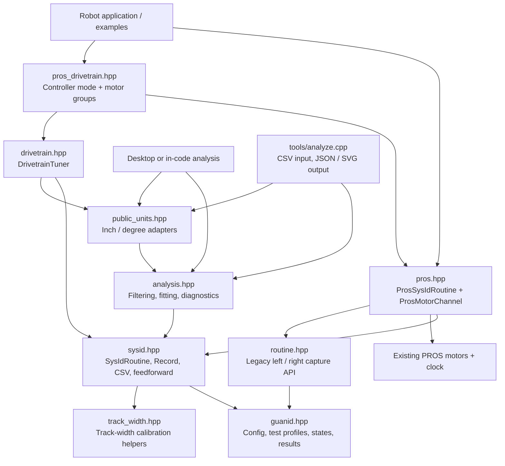
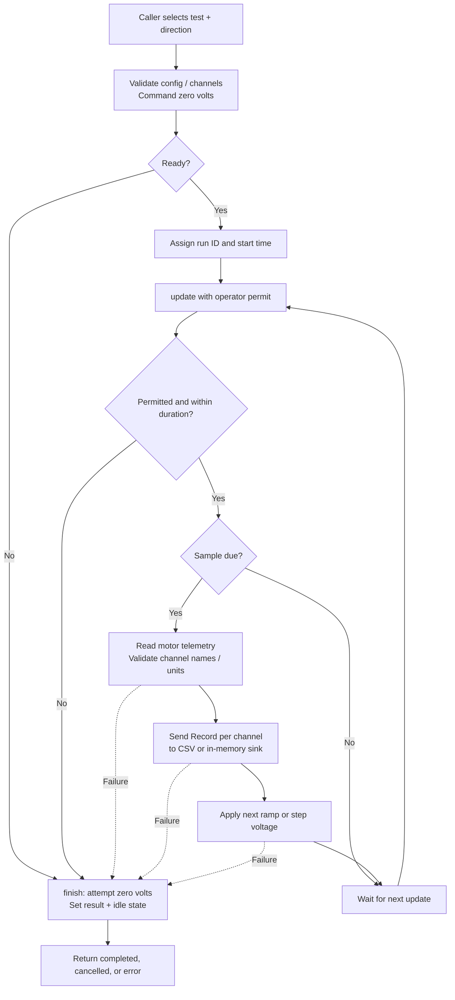
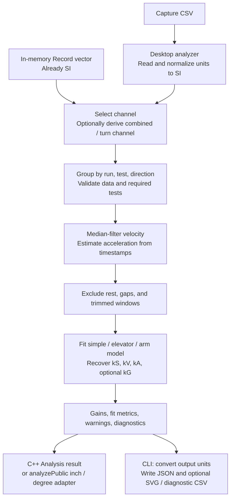

# Code structure and flow

These Mermaid diagrams cover the named-channel API used by the current examples.
Arrows in the structure diagram mean “uses.” The library is header-only;
`tools/analyze.cpp` is a separate desktop program.

## Code structure

Public headers live in `include/guanid/`. `examples/` shows robot and simulated
captures; `tests/` and `scripts/` cover host behavior and packaging. The
track-width helpers are also usable on their own and command no motors.

## Capture flow

Blocking `quasistatic()` / `dynamic()` calls run this update loop internally.
The periodic API leaves update scheduling to the caller. Telemetry is recorded
before the next command; the first sample is taken at zero commanded voltage.
An explicit `cancel()` also enters the stop path. If stopping fails, the result
is `hardware_error`. Run forward and reverse tests for both profiles separately.

## Drivetrain session

The PROS driver mode checks its operator and competition interlocks, temporarily
sets degree encoders, and hands each hold-to-run profile to `DrivetrainTuner`.
A cancelled profile rolls back to its record checkpoint and can be retried.
An external CSV sink has already seen those records. After four completed
profiles, the session fits each side, averages the side gains, and calculates
drive-limit and optional angular estimates. See [drivetrain tuning](drivetrain.md)
for custom controls and result fields.

## Analysis flow

Analysis failures return errors rather than usable gains. Inspect warnings and
fit diagnostics before applying a result. See [getting started](getting-started.md),
[units](units.md), and the [API reference](api.md) for details.
